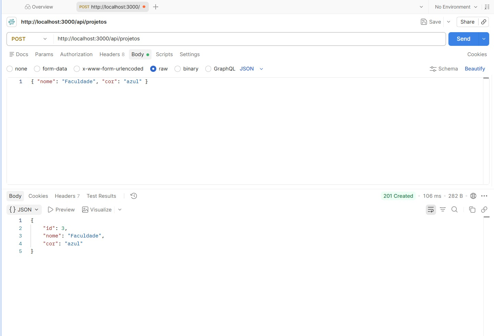
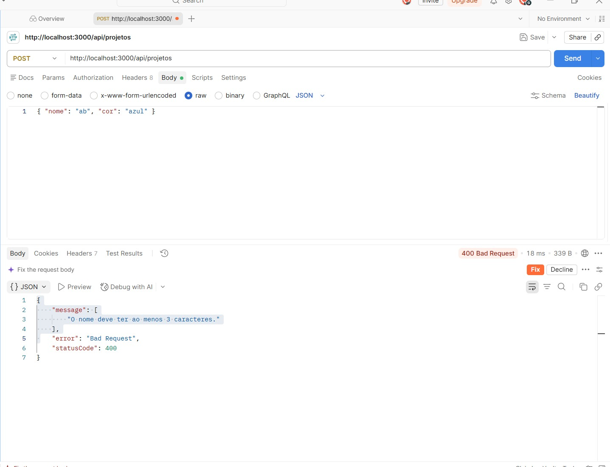
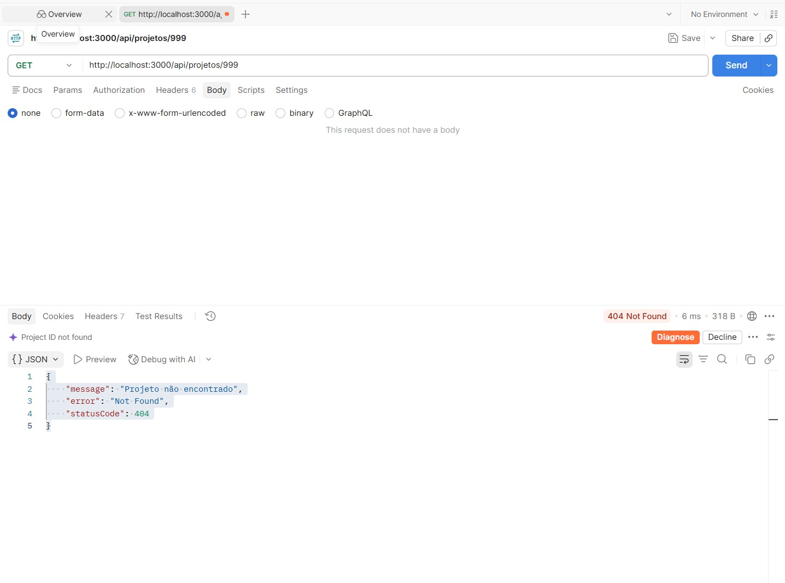
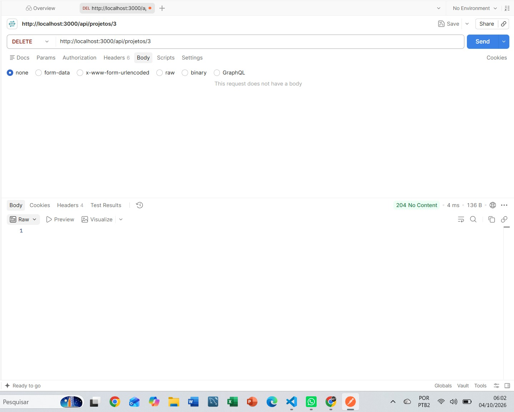

# Projeto 2: CRUD de Projetos (NestJS)

Atividade em casa da Aula 05 de Programação para Web 2. Continuação do backend de Tarefas feito em aula, agora com o recurso Projetos.

## Como rodar

```
npm install
npm run start:dev
```

A API sobe em `http://localhost:3000/api`. Os dados ficam em memória e somem quando o servidor reinicia.

## Rotas de projetos

| Método | Rota | Sucesso |
| ------ | ---- | ------- |
| GET | /api/projetos | 200 |
| GET | /api/projetos/:id | 200 (404 se não existir) |
| POST | /api/projetos | 201 |
| PUT | /api/projetos/:id | 200 |
| DELETE | /api/projetos/:id | 204 |

## Campos

| Campo | Regra |
| ----- | ----- |
| nome | obrigatório, de 3 a 60 caracteres |
| descricao | opcional, até 200 caracteres |
| cor | vermelho, verde, azul, amarelo ou roxo |

## Desafios feitos

Mensagens de erro personalizadas em todos os validadores do `CreateProjetoDto`, no mesmo padrão usado em tarefas.

## Testes no Postman

Criar projeto (201):



Validação do nome (400):



Projeto não encontrado (404):



Remover projeto (204):


